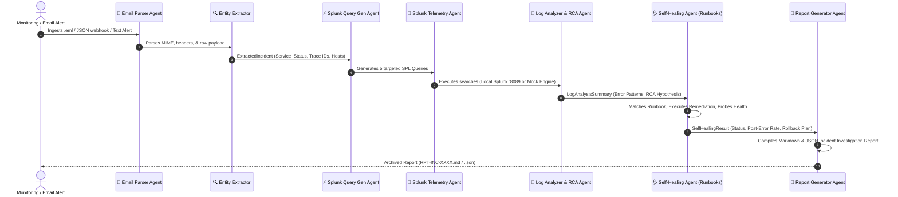

# 🛡️ Ops Support Multi-Agent System (with Self-Healing & Runbooks)

An enterprise-grade, end-to-end multi-agent system designed for automated operational incident response, log telemetry investigation with Splunk, root cause analysis (RCA), automated runbook/playbook execution, and executive report synthesis.

---

## 🏗️ Multi-Agent Architecture & Sequence Flow



---

## 🤖 Detailed Agent Directory & Task Breakdown

### 1. 📧 Email Alert Ingestion & Parsing Agent
- **Source File**: [`src/email_parser.py`](src/email_parser.py:1)
- **Role**: Serves as the primary operational entrypoint for all inbound incident signals.
- **Inputs**:
  - Raw MIME `.eml` email files
  - JSON alert webhooks (PagerDuty, Datadog, Prometheus, Alertmanager, AWS CloudWatch, ServiceNow)
  - Plain text alert descriptions
- **Core Tasks & Responsibilities**:
  - Decodes multi-part MIME email structures, character sets, and attachment boundaries.
  - Normalizes heterogeneous alert formats into a standardized internal `EmailMessage` model.
  - Preserves full payload fidelity for forensic traceability.
- **Output**: `EmailMessage` schema.

---

### 2. 🔍 Entity & Context Extraction Agent
- **Source File**: [`src/email_parser.py`](src/email_parser.py:155)
- **Role**: NLP and pattern matching specialist that converts unstructured email text into structured incident context.
- **Core Tasks & Responsibilities**:
  - **Service Identification**: Detects microservices (e.g., `payment-service`, `auth-service`, `cart-api`).
  - **Severity Classification**: Maps priority keywords to standard enterprise tiers (`P1 - Critical`, `P2 - High`, `P3 - Moderate`, `P4 - Low`).
  - **Distributed Trace Extraction**: Pinpoints UUIDs, Hex Traces (`trace_id`, `span_id`, `req-id`, `tx-id`).
  - **HTTP Status Code Mapping**: Captures client/server error codes (`504 Gateway Timeout`, `500 Internal Error`, `503 Service Unavailable`, `429 Too Many Requests`).
  - **Infrastructure Discovery**: Discovers affected hostnames, IP addresses, pods, and database endpoints.
  - **Exception Signature Mining**: Extracts stack trace error classes (`SocketTimeoutException`, `PSQLException`, `HikariPool ConnectionTimeout`).
- **Output**: `ExtractedIncident` schema.

---

### 3. ⚡ Splunk SPL Query Synthesis Agent
- **Source File**: [`src/splunk_query_gen.py`](src/splunk_query_gen.py:1)
- **Role**: Observability engineer generating precision Splunk Search Processing Language (SPL) queries.
- **Core Tasks & Responsibilities**:
  - **Query 1 (Primary Error Search)**:
    ```spl
    index=main (service="payment-service" OR sourcetype="*payment*") (status=504 OR status>=500) | head 50 | table _time, host, service, status, endpoint, error_message, _raw
    ```
  - **Query 2 (Distributed Trace ID Deep Dive)**: Correlates all hop logs matching the extracted trace ID across upstream API gateways and downstream workers.
  - **Query 3 (Status Code & Endpoint Aggregation)**: Computes failure rates grouped by API endpoint path.
  - **Query 4 (Infrastructure Failure Distribution)**: Identifies whether errors are localized to a specific host/pod or distributed across the entire fleet.
  - **Query 5 (Exception & Stack Trace Clustering)**: Uses regular expressions (`rex field=_raw`) to group top recurring exception classes.
- **Output**: `List[SplunkQuery]` containing parameterized search commands, time windows (`earliest`, `latest`), and target indices.

---

### 4. 🔎 Splunk Telemetry & Execution Agent
- **Source File**: [`src/splunk_client.py`](src/splunk_client.py:1)
- **Role**: Manages active connection with Splunk Enterprise / Splunk Cloud.
- **Core Tasks & Responsibilities**:
  - Connects to local or remote Splunk management port (`https://localhost:8089`) using `splunk-sdk`.
  - Executes search jobs in `oneshot` export mode and parses JSON event streams.
  - **Intelligent Offline/Test Mode**: Automatically switches to context-aware simulated event generation when Splunk daemon is offline, ensuring full pipeline testability.
- **Output**: `List[SplunkQueryResult]` containing extracted log events, execution latency, and summary metrics.

---

### 5. 🧠 Log Observability & RCA Reasoning Agent
- **Source File**: [`src/log_analyzer.py`](src/log_analyzer.py:1)
- **Role**: Diagnostic reasoning engine that analyzes Splunk telemetry and determines probable root cause.
- **Core Tasks & Responsibilities**:
  - Computes error ratios, failure distributions, and peak TPS impacts.
  - Isolates dominant failure modes:
    - *Downstream Timeout / Backpressure* (`504 Gateway Timeout` + `SocketTimeoutException`)
    - *Database Connection Starvation* (`HikariPool Connection is not available`)
    - *Database Concurrency Deadlocks* (`PSQLException: deadlock detected on ExclusiveLock`)
    - *Memory Pressure & Out of Memory* (`OOMKilled` / `OutOfMemoryError`)
  - Formulates a detailed **Root Cause Hypothesis** and impact statement.
- **Output**: `LogAnalysisSummary` schema.

---

### 6. 🩺 Self-Healing & Automated Remediation Agent
- **Source File**: [`src/self_healing_agent.py`](src/self_healing_agent.py:1)
- **Role**: SRE automation specialist executing pre-approved remediation playbooks and verifying health recovery.
- **Verification**: Executes post-healing synthetic health checks to verify error rate drops to `0.0%` and status transitions to `VERIFIED_HEALTHY`.
- **Output**: `SelfHealingResult` schema.

---

### 7. 📄 Ops Incident Report Generation Agent
- **Source File**: [`src/report_generator.py`](src/report_generator.py:1)
- **Role**: Documentation specialist synthesizing all forensic artifacts into executive and engineering reports.
- **Core Tasks & Responsibilities**:
  - Compiles comprehensive Markdown (`.md`) and JSON (`.json`) reports.
  - Structures reports into standardized sections (Incident Overview, Executive Summary, Self-Healing Remediation Audit, SPL Queries, Observability Metrics, RCA, Timeline, Remediation Action Plan, Escalation).
  - Saves reports automatically to [`reports/`](reports/).
- **Output**: `OpsIncidentReport` schema and persistent disk files.

---

### 8. 🎯 Master Multi-Agent Orchestrator
- **Source File**: [`src/agent.py`](src/agent.py:1)
- **Role**: Master pipeline conductor coordinating task handoffs and state across all specialized agents.

---

## 📖 Runbooks in the Application

### 📌 How Runbooks Are Used Across the 4 Lifecycle Stages

Runbooks (stored in [`runbooks/`](runbooks/)) define standardized operating procedures for incident mitigation. The application leverages them as follows:

```
  [ Incident Alert ] ──► [ RCA Engine ] ──► [ 1. Match Runbook ] 
                                                   │
  ┌────────────────────────────────────────────────┴────────────────────────────────┐
  │                                                                                 │
  ▼                                                                                 ▼
[ 2. Auto-Execute (Self-Healing) ]                               [ 3. Embed in Incident Report ]
- Trigger circuit breaker / restart pods                         - Step-by-step guidance for On-Call
- Verify error drop via synthetic probe                          - Splunk queries to monitor
                                                                 - Rollback instructions (Stage 4)
```

1. **Trigger & Policy Matching (`src/self_healing_agent.py`)**:
   - The RCA engine identifies the incident failure mechanism (e.g., `SocketTimeoutException` or `PSQLException deadlock`).
   - The Self-Healing Agent matches the incident to a specific Runbook in [`runbooks/`](runbooks/) and validates safety policies (`risk_level: LOW/MEDIUM`, `auto_remediation_allowed: true`).

2. **Automated Playbook Execution (`src/self_healing_agent.py`)**:
   - The agent executes the runbook’s automated commands (e.g. activate circuit breaker, adjust client timeouts, flush connection pool leases, cancel deadlocked backend transactions).

3. **Post-Healing Health Verification**:
   - The agent triggers the runbook's verification health probe to confirm service health returns to `200 OK` and error rate drops to `0.0%`.

4. **Action Plans & Rollback Procedures (`src/report_generator.py`)**:
   - The runbook’s manual escalation steps and exact **Rollback Commands** are embedded directly into the generated Incident Report (`reports/`).

---

### 📚 Available Runbook Catalog

| Runbook File | Runbook ID | Failure Trigger | Automated Mitigation Command | Rollback Procedure |
| :--- | :--- | :--- | :--- | :--- |
| [`runbooks/RB-NET-504-DOWNSTREAM-TIMEOUT.yaml`](runbooks/RB-NET-504-DOWNSTREAM-TIMEOUT.yaml) | `RB-NET-504` | HTTP 504 / Downstream Timeout | Activate circuit breaker & throttle client timeout to 10s | Disable circuit breaker & restore 30s timeout |
| [`runbooks/RB-DB-500-DEADLOCK.yaml`](runbooks/RB-DB-500-DEADLOCK.yaml) | `RB-DB-500` | PostgreSQL Deadlock / ExclusiveLock | Cancel idle blocking transactions (`pg_cancel_backend`) | N/A (Transient Locks released) |
| *Built-in DB Pool Runbook* | `PLAYBOOK-DB-02` | HikariCP Connection Pool Exhaustion | Flush connection leases & rolling pod restart | Rollback Kubernetes deployment |
| *Built-in K8s OOM Runbook* | `PLAYBOOK-K8S-03` | Memory Exhaustion (OOMKilled) | Auto-scale deployment replicas (+50%) & drain pods | Scale back replica count |

---

### 📄 Example Runbook Schema ([`runbooks/RB-NET-504-DOWNSTREAM-TIMEOUT.yaml`](runbooks/RB-NET-504-DOWNSTREAM-TIMEOUT.yaml))

```yaml
id: "RB-NET-504"
name: "Downstream Gateway Timeout & Circuit Breaker Remediation"
target_services:
  - "payment-service"
  - "checkout-service"
severity_trigger: ["P1 - Critical", "P2 - High"]

symptoms:
  - "HTTP 504 Gateway Timeout on /api/v1/payments/process"
  - "java.net.SocketTimeoutException: Read timed out after 30000ms"

safety_policy:
  risk_level: "LOW"
  auto_remediation_allowed: true
  requires_human_approval: false

automated_playbook:
  step_1_circuit_breaker:
    description: "Activate circuit breaker to fail fast and prevent thread pool saturation"
    command: "consul kv put config/payment-service/circuit_breaker_enabled true"
  step_2_throttle_timeout:
    description: "Reduce HTTP client timeout from 30s to 10s"
    command: "kubectl set env deployment/payment-service CLIENT_TIMEOUT_MS=10000 -n production"
  step_3_verification:
    description: "Verify synthetic health probes return HTTP 200"
    command: "curl -I -f https://payment-service.internal/health"

rollback:
  command: "consul kv put config/payment-service/circuit_breaker_enabled false"
  description: "Disable circuit breaker once downstream vendor recovers"
```

---

## 🚀 Quick Start Guide

### 1. Requirements & Installation
Ensure Python 3.10+ is installed:
```bash
python3 -m pip install -r requirements.txt
```

### 2. Configure Splunk (Optional)
If running a local Splunk instance, update your `.env` configuration (see [`.env.example`](.env.example)):
```bash
SPLUNK_HOST=localhost
SPLUNK_PORT=8089
SPLUNK_USERNAME=admin
SPLUNK_PASSWORD=your_password
SPLUNK_SCHEME=https
SPLUNK_INDEX=main
SPLUNK_VERIFY_SSL=false
```

To test connectivity to your Splunk instance:
```bash
./run.sh --check-splunk
# OR
python3 run.py --check-splunk
```

---

## 🧪 Running & Testing the Pipeline

### Analyze a Specific Alert Email
```bash
./run.sh --file data/sample_emails/payment_gateway_504_timeout.eml
```

### Run All Sample Incident Alerts
```bash
./run.sh --test-all
```

### Interactive Mode (Paste Raw Alert Text into Terminal)
```bash
./run.sh --interactive
```

### Run Full Pytest Test Suite
```bash
python3 -m pytest tests/ -v
```

---

## 📂 Project Structure

```
ops_support_multiagent_demo/
├── README.md                      # Comprehensive system & agent documentation
├── requirements.txt               # Python package dependencies
├── .env.example                   # Splunk connection configuration template
├── config.py                      # Global configuration and environment settings
├── run.py / run.sh                # CLI entry points and runner scripts
├── runbooks/                      # Standard Operating Runbooks & Playbooks (YAML)
│   ├── RB-NET-504-DOWNSTREAM-TIMEOUT.yaml
│   └── RB-DB-500-DEADLOCK.yaml
├── src/
│   ├── __init__.py
│   ├── models.py                  # Pydantic data schemas for all agents
│   ├── email_parser.py            # Email parsing & entity extraction agents
│   ├── splunk_query_gen.py        # Splunk SPL query generation agent
│   ├── splunk_client.py           # Splunk API client & mock telemetry engine
│   ├── log_analyzer.py            # Log observability & root cause reasoning agent
│   ├── self_healing_agent.py      # Automated remediation playbooks & verification
│   ├── report_generator.py        # Markdown and JSON report compiler agent
│   └── agent.py                   # Master multi-agent workflow orchestrator
├── data/
│   └── sample_emails/             # Sample incident alerts for testing
│       ├── payment_gateway_504_timeout.eml
│       ├── auth_service_db_deadlock.eml
│       └── cart_api_datadog_alert.json
├── reports/                       # Generated incident investigation reports (.md & .json)
└── tests/                         # Unit and integration test suite
    ├── test_email_parser.py
    ├── test_splunk_query_gen.py
    ├── test_splunk_client.py
    ├── test_log_analyzer.py
    ├── test_self_healing_agent.py
    └── test_end_to_end.py
```
